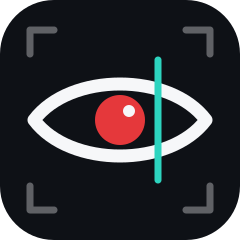
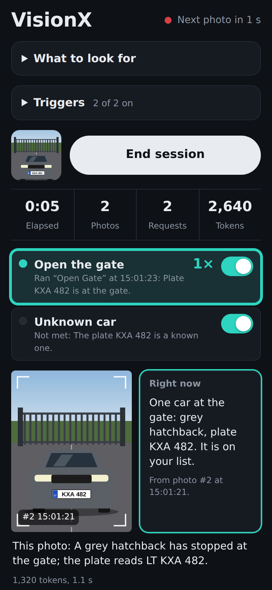
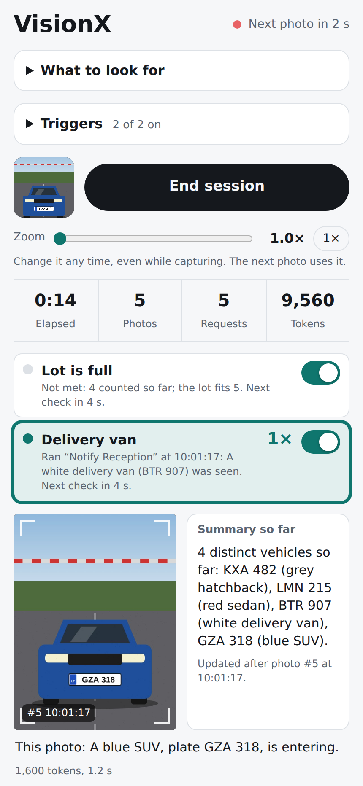
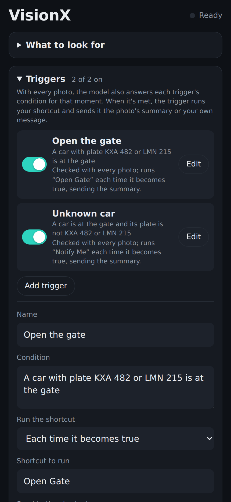
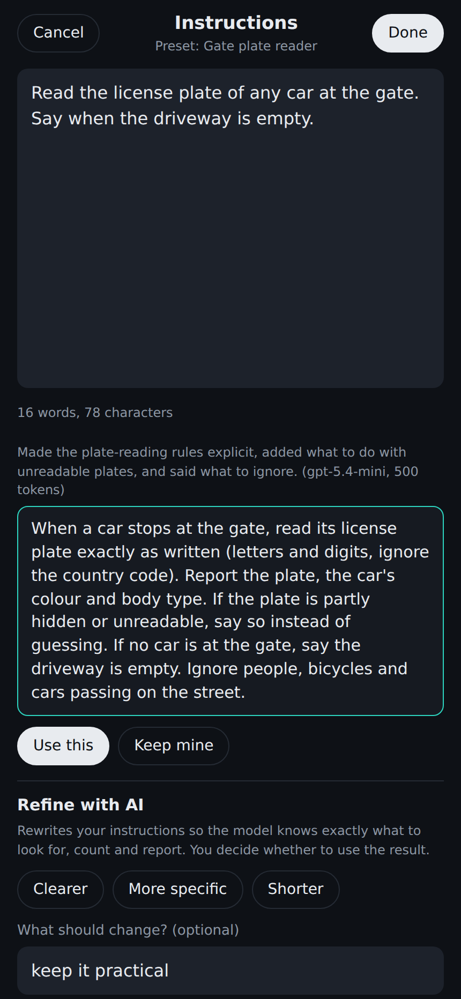
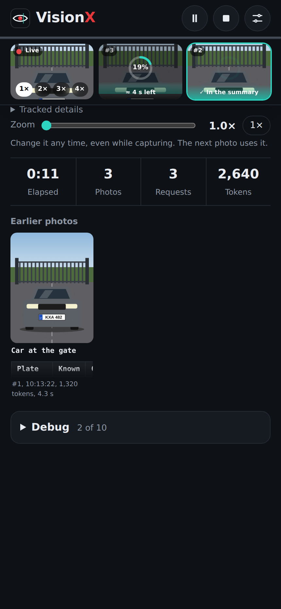
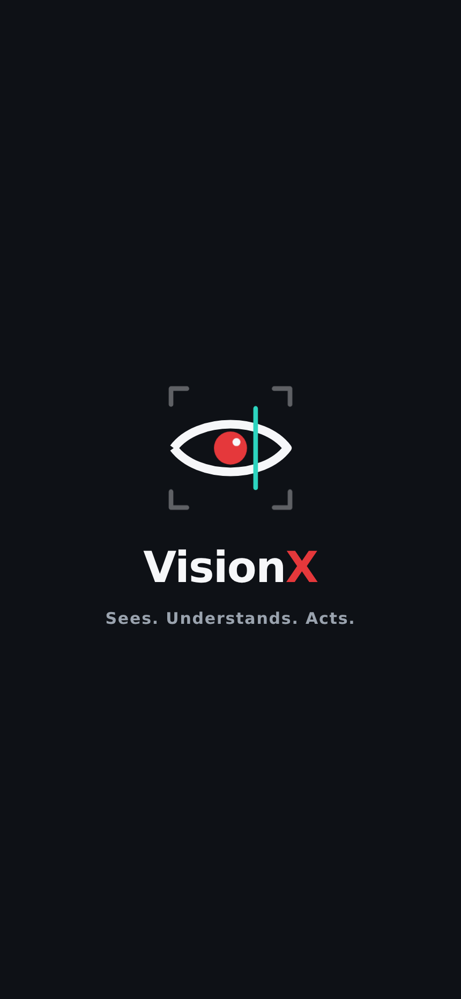
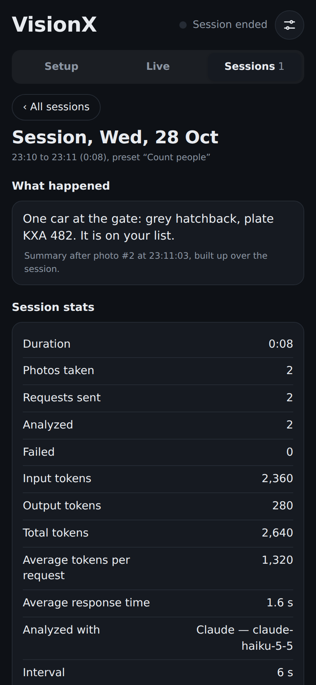

<p align="center"></p>

<h1 align="center">VisionX</h1>
<p align="center"><b>Sees. Understands. Acts.</b></p>

**Your iPhone as a smart camera, built with [Scriptable](https://scriptable.app).** VisionX takes a photo every few seconds, has an AI model (Claude, OpenAI or Apple Intelligence) look at it with your own instructions, and keeps a live summary of what it sees. When something you care about happens, it runs an Apple Shortcut, so it can open a gate, send a notification or switch on a light.

<p align="center">
  
  
  
  
</p>
<p align="center">
  
  
  
</p>
<p align="center"><sub>A known plate is read and the "Open Gate" shortcut runs · counting vehicles and plates over a session · setting up triggers · refining instructions with AI.<br>Screenshots of the app's real interface, rendered with a drawn test scene in place of the camera.</sub></p>

## Install

1. Get **[Scriptable](https://apps.apple.com/app/scriptable/id1405459188)** (free) on your iPhone.
2. In Scriptable, tap **+**, paste these two lines, name the script *VisionX Installer*, and tap **▶**:
   ```js
   const code = await new Request("https://raw.githubusercontent.com/gadominas/VisionX/main/install.js").loadString();
   await eval("(async () => {" + code + "\n})()");
   ```
3. Tap **Open VisionX**. Apple Intelligence works straight away. To use Claude or OpenAI, tap the **sliders icon** at the top, then **AI settings**, and add your own key (typed into a native iOS prompt and kept in the iOS Keychain).

**Update:** run *VisionX Installer* again. Presets, triggers and settings are kept.

**Rather not use the loader?** Paste [`install.js`](install.js) or [`VisionX.js`](VisionX.js) into a new script yourself.

## What it does

- **Timed capture.** It takes a photo every N seconds from the live camera, with no tapping.
- **Zoom while capturing.** Slide from 1× to 5× at any time, even mid-session; the next photo uses it. VisionX uses the camera's own zoom when iOS offers it and crops for anything beyond that.
- **Your instructions.** It does whatever you describe, such as "Count the different people and summarize them" or "Read the license plate of any car at the gate". Save instructions you like as presets.
- **Full-screen editor with AI refine.** Expand the instructions into a full-screen editor. **Refine with AI** rewrites them so the model knows exactly what to look for, count and ignore. Pick Clearer, More specific or Shorter, or say what should change, then use the suggestion or keep your own.
- **Sticky header.** Start, Pause/Resume and Stop, Settings, the tabs (Setup, Triggers, Live, Sessions) and a status line with the countdown to the next photo or what's being analyzed stay at the top on every tab.
- **Live tab.** Starting a session opens Live. One row of three small photos: the live camera (with 1×, 2×, 3× and 4× zoom buttons on it), the photo being analyzed (progress ring and time left, or a countdown to the next photo), and the last analyzed photo, outlined and marked "✓ In the summary". Under it the summary runs full width, then a compact trigger list (status badge, run count and time per trigger), stats, and earlier photos as small thumbnails.
- **Markdown summaries.** Summaries are shown in a fixed-width font and render Markdown from the model: headings, lists, tables, code blocks (for Unicode bar charts) and gauges (`<meter>`, `<progress>`). Ask for it in your instructions, for example "show a table of counts and a bar per category".
- **Saved sessions.** Ending a session saves it on this iPhone with its summary, stats, trigger results, last photos and debug log, and opens its report in the Sessions tab. The last 3 are kept by default, up to 10 (Settings › Capture).
- **Two summary modes.** Each photo can build on one running summary for the whole session, or be judged fresh on its own (see [Modes](#modes)).
- **Triggers.** A trigger has a plain-language condition, such as "A car with plate KXA 482 is at the gate", and a shortcut to run. When the model says the condition is met, the shortcut runs and receives the capture summary or your own message. Live rows show which triggers are waiting, checking or have fired, and each one can be switched on or off at any time.
- **Debug log.** The last 10 photos are kept with exactly what was sent (instructions, context, request settings) and what came back, both as received and as understood, plus any trigger checks. JSON is syntax-highlighted, and **Copy as JSON** copies the log without the photos.
- **Session stats.** At the end you see the duration, photos taken, requests sent, tokens used, and how many times each trigger fired.
- **Claude, OpenAI or Apple Intelligence.** Pick any model your Claude or OpenAI key can use in **AI settings**, test the connection and see your token usage per day, feature and model. Or use Apple Intelligence through Shortcuts with no API key.
- **Settings** (sliders icon at the top): colours (Auto or six palettes, VisionX teal in all), layout (Comfortable, Compact, or Tiny: older photos as one line each, tap to expand), text size and headline font, AI settings, update checks, and Capture limits (AI request time limit, photos kept on screen and in Debug) with Reset. Saved in iCloud Drive › Scriptable › VisionX › `settings.json`; presets, triggers and session choices stay in `vision-session.json` on this iPhone. **Built with** links to the [shared blueprints](https://github.com/gadominas/app-blueprints) VisionX follows ([docs/BLUEPRINTS.md](docs/BLUEPRINTS.md)).
- **Launch screen.** VisionX opens on its logo for 2.4 seconds: the eye draws itself, then "Sees. Understands. Acts." Tap to skip; with Reduce Motion it appears without movement. It is the shared [launch-screen](https://github.com/gadominas/app-blueprints/blob/main/blueprints/launch-screen.md) blueprint, so all the apps start the same way.

## Use cases

**Open the gate for a known car.** Point the phone at the driveway and use fresh mode with the instruction "Read the license plate of any car at the gate". Add a trigger "A car with plate KXA 482 or LMN 215 is at the gate" that runs a shortcut controlling your HomeKit gate or garage door, and a second trigger for unknown plates that just notifies you. Use "Each time it becomes true" so the gate opens once per arrival, not on every photo.

> A license plate is not proof of identity, because plates can be copied or misread. Use this for convenience together with other safeguards, not as the only lock.

**Count cars and plates.** At a parking entrance, keep "Build up over the session" on and ask it to count distinct vehicles and list their plates. The model tracks each vehicle, so the same car isn't counted twice. A "Lot is full" trigger can close a barrier or switch a sign once more than N cars have entered.

**Count plates in a kitchen.** Aim it at the pass and ask it to count plated dishes going out, grouped by dish. At the end of service you have a tally without anyone keeping notes.

**Know when the delivery arrives.** "A courier or a delivery van is at the door" can trigger a notification, a doorbell chime on a HomePod, or unlocking a parcel box.

**Room and event headcount.** "Count the different people in the room" with a trigger at a capacity limit for meeting rooms, classrooms or small events.

**Safety checks.** "Someone is working at the bench without safety glasses", or "The stove is on and nobody is in the kitchen", can trigger an alert.

**Shelf and stock watch.** "Any shelf section is empty" can trigger a restock reminder in Reminders.

**Wildlife and pets.** Count species at a bird feeder over a morning, or get a notification when the dog is on the sofa.

## How to use it

1. Open **What to look for**, write your instructions (or pick a preset) and set how often to take a photo.
2. Choose **Analyze with**: the Claude or OpenAI model set in **AI settings**, or Apple Intelligence.
3. Optional: open **Triggers** and add one or more.
4. Tap **Start session**, then **End session** to see the stats.

Keep the app in the foreground with the screen on during a session; set Auto-Lock to Never for long ones.

### Modes

The **Build up over the session** switch controls whether photos add to one summary or stand alone.

| | On (default) | Off (fresh for each photo) |
|---|---|---|
| Summary | Running summary of everything seen in the session | Only what the latest photo shows ("Right now") |
| Each request includes | The new photo and the summary so far | Only the new photo |
| Triggers are checked | On their own timer (every N seconds), against the summary | With every photo, inside the same request, at no extra cost |
| Best for | Counting and tallies over time | Catching a moment as it happens |

### Triggers

Each trigger has a name, a condition, the shortcut to run, and **when to check**:

- **Every few seconds**: on its own timer, independent of photos.
- **After each photo is analyzed**: right after every photo, against the updated summary. The next photo isn't taken until the check and any shortcut it runs have finished. In fresh mode, every trigger works this way.

And **when to run** the shortcut:

- **Each time it becomes true** (default): runs once, then waits until the condition is false again. With a summary that builds up, a condition like "a thumbs-up was seen" stays true, so this runs only once per session.
- **Each new occurrence**: runs whenever the condition happens again, for example every new thumbs-up. The check is told what had already happened the last time the shortcut ran.
- **Only the first time**: runs at most once per session.
- **Every check while true**: runs on every check where the condition is met.

If a trigger says "met" but its shortcut didn't run, the trigger row and the debug log say why.

Each trigger also chooses what its shortcut receives as **Shortcut Input** (text only; photos aren't sent):

- **The capture summary**: the running summary, or in fresh mode what the latest photo shows.
- **The photo's AI summary**: what the AI wrote about the latest photo.
- **The reply as received**: the model's latest reply, exactly as it came back.
- **The reply as understood**: that reply as VisionX read it (frame, summary, tracked details, trigger answers), as JSON.
- **Tracked details**: the counts and IDs the model keeps, as JSON.
- **Everything**: one JSON with the trigger and its reason, the photo's summary, the reply as received and as understood, the session summary, tracked details and stats. In Shortcuts, *Get Dictionary from Input* lets you pick fields.
- **A custom message** you type, such as `Gate opened for {reason} at {time}`. Placeholders: `{summary}`, `{frame}`, `{raw}`, `{parsed}`, `{state}`, `{all}`, `{reason}`, `{condition}`, `{check}` (the trigger check's own reply), `{name}`, `{shortcut}`, `{photo}`, `{phototime}`, `{time}`, `{date}`, `{instructions}`, `{elapsed}`, `{photos}`, `{requests}`, `{tokens}`, `{engine}`.

The debug log shows exactly what each trigger sent.

For example, a shortcut can use *Show Notification* with Shortcut Input, or *Control Home* to open a gate. Running a shortcut briefly switches to the Shortcuts app and back, and only one shortcut runs at a time.

## Apple Intelligence setup

Scriptable can't call Apple Intelligence directly, so VisionX runs a shortcut that uses the **Use Model** action. Choose the cloud model (Private Cloud Compute), because the on-device model may not accept images.

**Vision Session AI** analyzes photos:
1. **Take Photo**, with *Show Camera Preview* turned off.
2. **Resize Image**, width 768.
3. **Copy to Clipboard**, with the resized image.
4. **Use Model** (cloud). In the prompt, insert *Shortcut Input*, then the *Resized Image*. If it lets you pick the output type, choose *Text*.
5. **Stop and Output**, with the model's *Response*.

Run it once from Shortcuts to grant camera access. With Apple Intelligence, each photo briefly opens Shortcuts. VisionX reads the photo from the clipboard and clears it straight away.

**Run it hands-free.** Reading the clipboard makes iOS ask "Scriptable would like to paste from Shortcuts" for every photo. Either:
- allow it once: iPhone **Settings › Apps › Scriptable › Paste from Other Apps › Allow**, or
- turn off **Show each photo here** in VisionX. Analysis and triggers keep working; only the photo isn't shown, and step 3 isn't needed.

**Vision Session Check** checks triggers. It's only needed with Apple Intelligence when "Build up over the session" is on:
1. **Use Model** (cloud), with *Shortcut Input* as the prompt.
2. **Stop and Output**, with the model's *Response*.

Both shortcut names can be changed in the app.

## Updates and what's new

VisionX checks for a new version each time it opens. When one is out, a sheet shows its three best features, with **Update now** and **Later**. Update now installs the new version over the current one; close and reopen VisionX to start it. Later, or tapping outside the sheet, hides the offer for two days. Your presets, triggers and settings are kept.

The full history is in [CHANGELOG.md](CHANGELOG.md). Versions before 1.7.0 can't update themselves, so run *VisionX Installer* once more to get 1.7.0. To turn update checks off, switch off **Settings › Updates › Offer new versions**; **Check for updates now** checks at once.

## Privacy

- During a session, photos are kept in memory: the last three on screen and the last ten in the debug log.
- When a session ends, it is saved with those photos in Scriptable's local Documents folder (`VisionX-sessions`) on this iPhone only, never iCloud or Photos. Only the last 3 sessions are kept (up to 10, set in Settings › Capture); older ones are deleted, and you can delete any session from its report.
- Each photo is sent to the model you choose: Claude, OpenAI or Apple's Private Cloud Compute.
- Claude and OpenAI keys stay in the iOS Keychain and are only sent to their own provider. The app's page never receives them.
- Presets, triggers and settings are saved in Scriptable's local Documents folder as `vision-session.json`.

## Notes

- Claude and OpenAI calls go through Scriptable's native networking and one shared AI call, set up like the other apps (see [app-blueprints](https://github.com/gadominas/app-blueprints) and [docs/BLUEPRINTS.md](docs/BLUEPRINTS.md)).
- VisionX follows four shared blueprints: in-app updates, settings, AI configuration and launch screen. **Settings › Built with** lists them with their versions; [docs/BLUEPRINTS.md](docs/BLUEPRINTS.md) adds the deviations.
- Token counts are shown for Claude and OpenAI, per session and in **AI settings › Token usage**. Apple doesn't report them.
- Apple Intelligence is asked for a simple labelled reply (FRAME, SUMMARY, STATE). VisionX also reads JSON, fenced JSON and bold labels, and if a reply can't be read at all, it's shown as the summary rather than leaving it empty.
- How well it reads plates, counts and judges conditions depends on the model, the light and the camera angle. Test a setup before relying on it.
