<div align="center">


# VisionX

**Sees. Understands. Acts.**

Your iPhone as an AI smart camera: it takes a photo every few seconds, has Claude, OpenAI or Apple Intelligence look at it with your instructions, and runs an Apple Shortcut when something happens.<br>An iPhone and iPad app for [Scriptable](https://scriptable.app). One file, no server, no sign-up.

[](CHANGELOG.md)
[](https://apps.apple.com/app/scriptable/id1405459188)
[](#ai)
[](docs/BLUEPRINTS.md)
[](https://github.com/gadominas/VisionX/commits)
[](LICENSE)

</div>

<p align="center">
  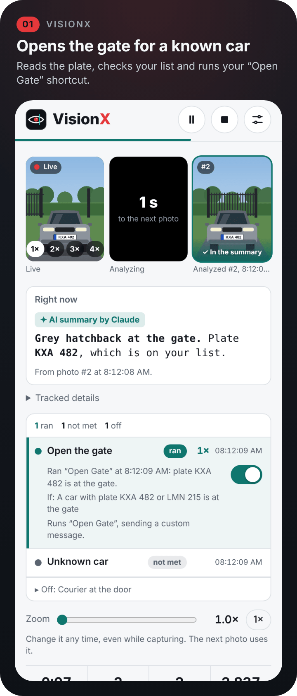
  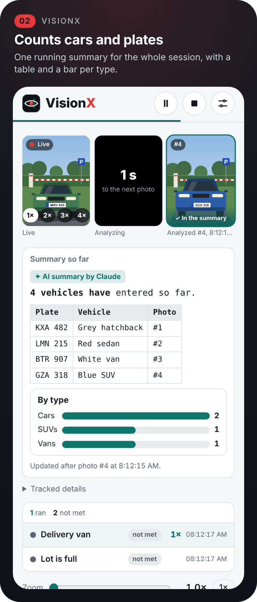
  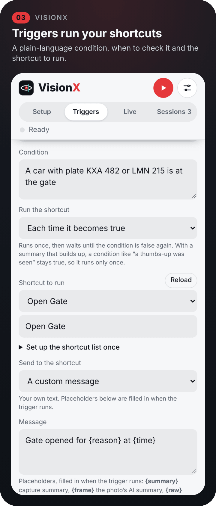
</p>

> [!NOTE]
> Screenshots are rendered from the app's real interface with invented sample data. A drawn test scene stands in for the camera, and every plate in it is invented.

> [!IMPORTANT]
> **Convenience, not security.** A license plate can be copied or misread, and results depend on the model, the light and the camera angle. See [Disclaimer](#disclaimer).

## Highlights

- **Timed capture.** It takes a photo every N seconds from the live camera, with no tapping. Zoom from 1× to 5× at any time, even mid-session; VisionX uses the camera's own zoom when iOS offers it and crops for anything beyond that.
- **Triggers run your shortcuts.** A trigger has a plain-language condition, such as "A car with plate KXA 482 is at the gate", and a shortcut to run. When the model says the condition is met, the shortcut runs and receives the capture summary or your own message, so it can open a gate, send a notification or switch on a light.
- **Two summary modes.** Each photo can build on one running summary for the whole session, for counting and tallies, or be judged fresh on its own, for catching a moment (see [Modes](#modes)).
- **Live tab.** Starting a session opens Live and hides the tabs and status line until it stops. The live camera, the photo being analyzed and the last analyzed photo sit in one row that stays pinned as you scroll and shrinks to half its height.
- **Markdown summaries.** Summaries render Markdown from the model: headings, lists, tables, code blocks, donut, bar and line charts, headline-number tiles, and gauges (`<meter>`, `<progress>`). **✨ Make it visual** rewrites your instructions to ask for them.
- **Refine with AI.** Expand the instructions into a full-screen editor. **Refine with AI** rewrites them so the model knows exactly what to look for, count and ignore. Pick Clearer, More specific or Shorter, or say what should change, then use the suggestion or keep your own.
- **Your instructions, as presets.** It does whatever you describe, such as "Count the different people and summarize them". Save instructions you like as presets, and choose Claude, OpenAI or Apple Intelligence to analyze the photos.
- **Saved sessions.** Ending a session saves it on this iPhone with its summary, stats, trigger results, last photos and debug log, and opens its report in the Sessions tab.
- **Debug log.** The last 10 photos are kept with exactly what was sent and what came back, as received and as understood, plus every trigger check. **Copy as JSON** copies the log without the photos.
- **Widget, launch screen, settings and updates.** A Home Screen and Lock Screen widget, a launch screen where the eye draws itself, Settings with colours and layout, and in-app updates, all from the shared [app-blueprints](https://github.com/gadominas/app-blueprints).

## Screenshots

<p align="center">
  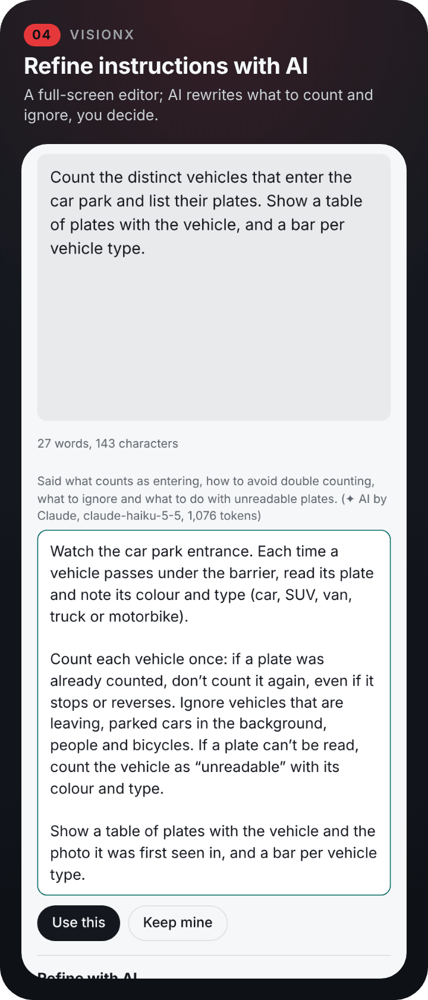
  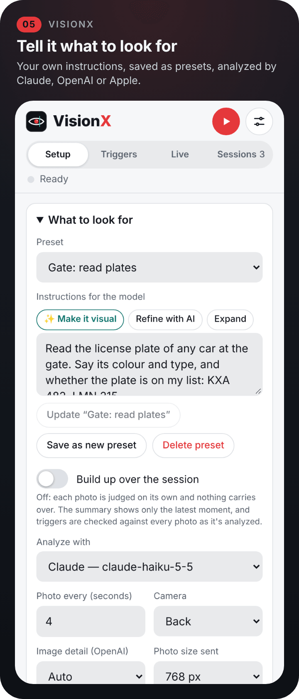
  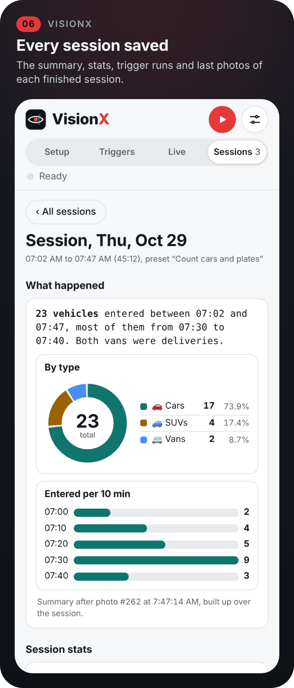
</p>
<p align="center">
  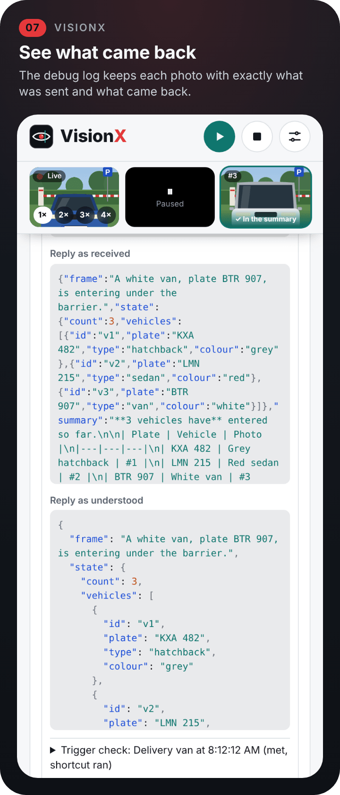
  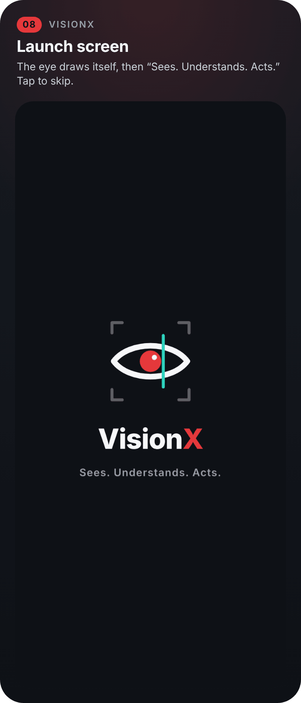
  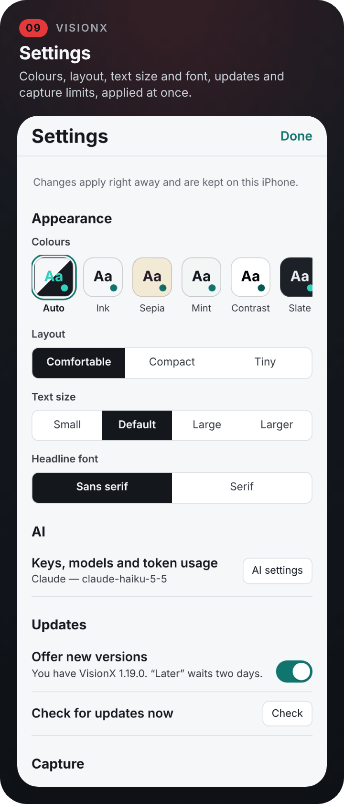
</p>
<p align="center">
  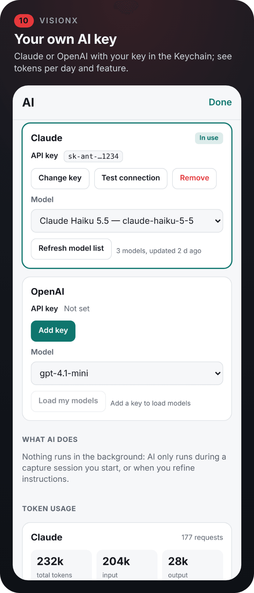
  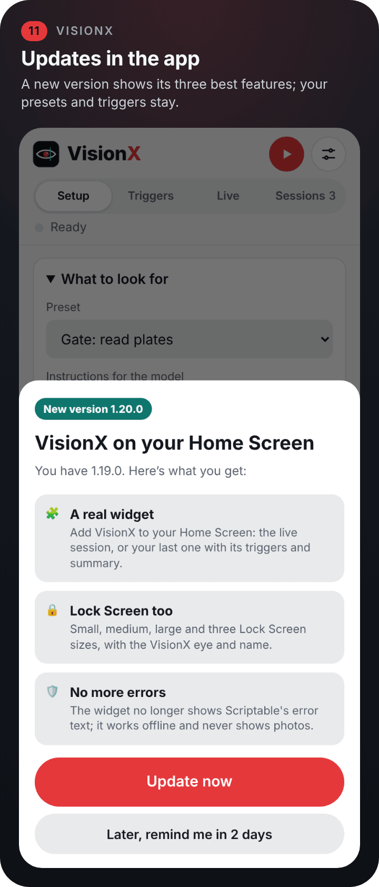
  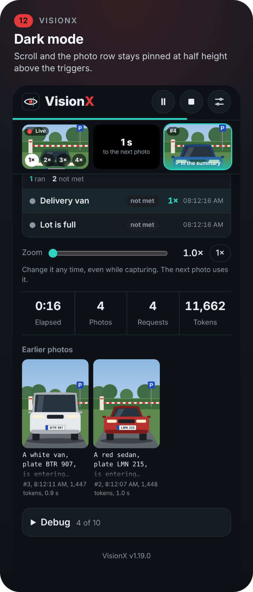
</p>
<p align="center">
  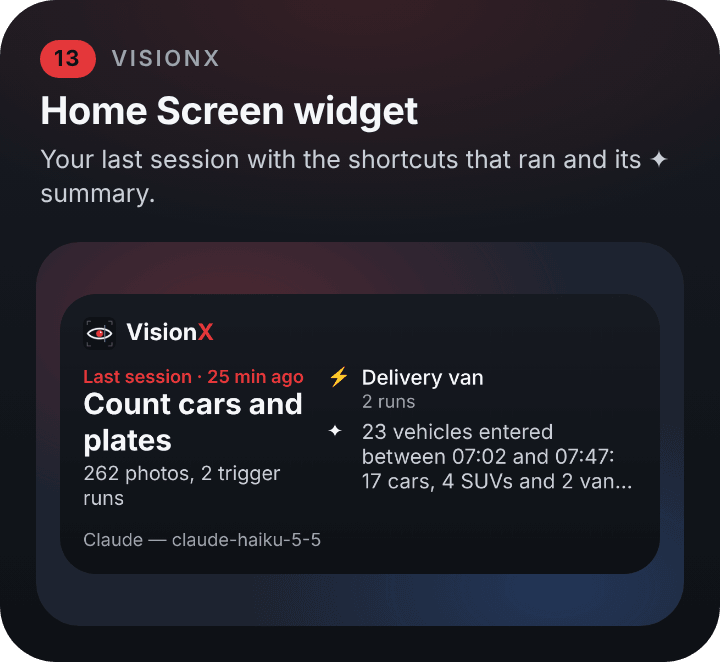
  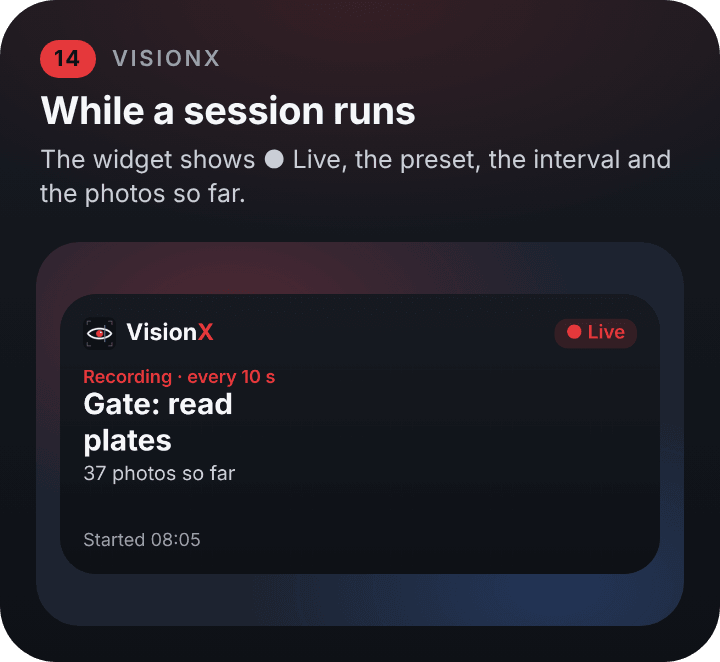
</p>

## Install

1. Get **[Scriptable](https://apps.apple.com/app/scriptable/id1405459188)** (free) on your iPhone or iPad.
2. In Scriptable, tap **+**, paste these two lines, name the script *VisionX Installer*, and tap **▶**:
   ```js
   const code = await new Request("https://raw.githubusercontent.com/gadominas/VisionX/main/install.js").loadString();
   await eval("(async () => {" + code + "\n})()");
   ```
3. Tap **Open VisionX**. Apple Intelligence works straight away. To use Claude or OpenAI, tap the **sliders icon** at the top, then **AI settings**, and add your own key (typed into a native iOS prompt and kept in the iOS Keychain).

To update, run *VisionX Installer* again; presets, triggers and settings are kept.

<details>
<summary><b>Install by hand</b></summary>

Rather not use the loader? Paste [`install.js`](install.js) or [`VisionX.js`](VisionX.js) into a new script in Scriptable yourself.

</details>

What else you need:

- **To analyze photos:** a [Claude](https://console.anthropic.com/settings/keys) or [OpenAI](https://platform.openai.com/api-keys) API key, or an iPhone with Apple Intelligence and the *Vision Session AI* shortcut (see [Apple Intelligence setup](#apple-intelligence-setup)).
- **For triggers:** the Apple Shortcuts you want them to run, such as one that opens your HomeKit gate or shows a notification.

## How to use it

1. On **Setup**, open **What to look for**, write your instructions (or pick a preset) and set how often to take a photo.
2. Choose **Analyze with**: the Claude or OpenAI model set in **AI settings**, or Apple Intelligence.
3. Optional: open **Triggers** and add one or more.
4. Tap **▶** (or **Start session**). **⏸** pauses, **■** ends the session and opens its report with the stats.

Keep the app in the foreground with the screen on during a session; set Auto-Lock to Never for long ones.

The header keeps Start, Pause/Resume and Stop, Settings, the tabs (Setup, Triggers, Live, Sessions) and a status line with the countdown to the next photo on every tab. During a session only the logo and the Pause, Stop and Settings buttons stay. Under them, one row of three small photos: the live camera (with 1×, 2×, 3× and 4× zoom buttons on it), the photo being analyzed (progress ring and time left, or a countdown to the next photo), and the last analyzed photo, outlined and marked "✓ In the summary". Below it come the summary, the triggers, the zoom slider, the stats, earlier photos and the debug log.

### Use cases

**Open the gate for a known car.** Point the phone at the driveway and use fresh mode with the instruction "Read the license plate of any car at the gate". Add a trigger "A car with plate KXA 482 or LMN 215 is at the gate" that runs a shortcut controlling your HomeKit gate or garage door, and a second trigger for unknown plates that just notifies you. Use "Each time it becomes true" so the gate opens once per arrival, not on every photo.

> A license plate is not proof of identity, because plates can be copied or misread. Use this for convenience together with other safeguards, not as the only lock.

**Count cars and plates.** At a parking entrance, keep "Build up over the session" on and ask it to count distinct vehicles and list their plates. The model tracks each vehicle, so the same car isn't counted twice. A "Lot is full" trigger can close a barrier or switch a sign once more than N cars have entered.

<details>
<summary><b>More use cases</b></summary>

**Count plates in a kitchen.** Aim it at the pass and ask it to count plated dishes going out, grouped by dish. At the end of service you have a tally without anyone keeping notes.

**Know when the delivery arrives.** "A courier or a delivery van is at the door" can trigger a notification, a doorbell chime on a HomePod, or unlocking a parcel box.

**Room and event headcount.** "Count the different people in the room" with a trigger at a capacity limit for meeting rooms, classrooms or small events.

**Safety checks.** "Someone is working at the bench without safety glasses", or "The stove is on and nobody is in the kitchen", can trigger an alert.

**Shelf and stock watch.** "Any shelf section is empty" can trigger a restock reminder in Reminders.

**Wildlife and pets.** Count species at a bird feeder over a morning, or get a notification when the dog is on the sofa.

</details>

### Instructions and presets

Write what the model should do in **Instructions for the model**. **Save as new preset** keeps them under a name; **Update "…"** saves changes to the preset you picked; **Delete preset** asks for a second tap. **Expand** opens the full-screen editor, where **Refine with AI** offers **✨ Make it visual**, **Clearer**, **More specific** and **Shorter**, or your own request in **What should change?**. The suggestion appears with **Use this** and **Keep mine**; **Undo refine** brings your text back, and **Done** keeps the result.

Under the instructions you also set **Photo every (seconds)**, **Camera** (back or front), **Image detail (OpenAI)** and **Photo size sent** (512 to 1536 px).

### Modes

The **Build up over the session** switch controls whether photos add to one summary or stand alone.

| | On (default) | Off (fresh for each photo) |
|---|---|---|
| Summary | Running summary of everything seen in the session | Only what the latest photo shows ("Right now") |
| Each request includes | The new photo and the summary so far | Only the new photo |
| Triggers are checked | On their own timer (every N seconds), against the summary | With every photo, inside the same request, at no extra cost |
| Best for | Counting and tallies over time | Catching a moment as it happens |

### Triggers

On the **Triggers** tab, **Add trigger** asks for a name, a condition, when to check it, when to run the shortcut, the shortcut and what to send it. Each trigger has a switch, so it can be turned on or off at any time, even during a session; **Duplicate** saves a copy to change. On Live, each trigger shows whether it is waiting, checking, met or has run, and how many times. If a trigger says "met" but its shortcut didn't run, the trigger row and the debug log say why.

<details>
<summary><b>Every trigger option</b></summary>

**When to check** (with "Build up over the session" on):

- **Every few seconds**: on its own timer, independent of photos.
- **After each photo is analyzed**: right after every photo, against the updated summary. The next photo isn't taken until the check and any shortcut it runs have finished. In fresh mode, every trigger works this way.

**Run the shortcut:**

- **Each time it becomes true** (default): runs once, then waits until the condition is false again. With a summary that builds up, a condition like "a thumbs-up was seen" stays true, so this runs only once per session.
- **Each new occurrence**: runs whenever the condition happens again, for example every new thumbs-up. The check is told what had already happened the last time the shortcut ran.
- **Only the first time**: runs at most once per session.
- **Every check while true**: runs on every check where the condition is met.

**Send to the shortcut** sets what the shortcut receives as **Shortcut Input** (text only; photos aren't sent):

- **The capture summary**: the running summary, or in fresh mode what the latest photo shows.
- **The photo's AI summary**: what the AI wrote about the latest photo.
- **The reply as received**: the model's latest reply, exactly as it came back.
- **The reply as understood**: that reply as VisionX read it (frame, summary, tracked details, trigger answers), as JSON.
- **Tracked details**: the counts and IDs the model keeps, as JSON.
- **Everything**: one JSON with the trigger and its reason, the photo's summary, the reply as received and as understood, the session summary, tracked details and stats. In Shortcuts, *Get Dictionary from Input* lets you pick fields.
- **A custom message** you type, such as `Gate opened for {reason} at {time}`. Placeholders: `{summary}`, `{frame}`, `{raw}`, `{parsed}`, `{state}`, `{all}`, `{reason}`, `{condition}`, `{check}` (the trigger check's own reply), `{name}`, `{shortcut}`, `{photo}`, `{phototime}`, `{time}`, `{date}`, `{instructions}`, `{elapsed}`, `{photos}`, `{requests}`, `{tokens}`, `{engine}`.

The debug log shows exactly what each trigger sent.

For example, a shortcut can use *Show Notification* with Shortcut Input, or *Control Home* to open a gate. Running a shortcut briefly switches to the Shortcuts app and back, and only one shortcut runs at a time.

**Pick shortcuts from a list.** Scriptable can't list your shortcuts itself, so VisionX runs a helper once. In Shortcuts, create a shortcut named **VisionX Shortcut List** with **Get My Shortcuts**, then **Combine Text** (My Shortcuts with New Lines), then **Stop and Output** with the Combined Text. Back in VisionX, tap **Load my shortcuts** in the trigger form; your shortcuts then appear in a menu and as suggestions while you type.

</details>

### Sessions and the debug log

Ending a session saves it in the **Sessions** tab with its summary ("What happened", or "Last moment" in fresh mode), the session stats (duration, photos taken, requests sent, tokens used, trigger checks and how many times each trigger ran), the triggers, the last photos, the tracked details, the instructions used and its debug log. The last 3 sessions are kept by default, up to 10 (**Settings › Capture**). **Delete this session** asks for a second tap.

During a session, **Debug** on the Live tab keeps the newest photos (10 by default) with exactly what was sent (instructions, context, request settings) and what came back, both as received and as understood, plus every trigger check and what VisionX did about it. JSON is syntax-highlighted, and **Copy as JSON** copies the log without the photos.

### Apple Intelligence setup

Scriptable can't call Apple Intelligence directly, so VisionX runs a shortcut that uses the **Use Model** action. Choose the cloud model (Private Cloud Compute), because the on-device model may not accept images. With Apple Intelligence, each photo briefly opens Shortcuts, and Apple doesn't report token counts.

<details>
<summary><b>Set up the two shortcuts</b></summary>

**Vision Session AI** analyzes photos:
1. **Take Photo**, with *Show Camera Preview* turned off.
2. **Resize Image**, width 768.
3. **Copy to Clipboard**, with the resized image.
4. **Use Model** (cloud). In the prompt, insert *Shortcut Input*, then the *Resized Image*. If it lets you pick the output type, choose *Text*.
5. **Stop and Output**, with the model's *Response*.

Run it once from Shortcuts to grant camera access. VisionX reads the photo from the clipboard and clears it straight away.

**Run it hands-free.** Reading the clipboard makes iOS ask "Scriptable would like to paste from Shortcuts" for every photo. Either:
- allow it once: iPhone **Settings › Apps › Scriptable › Paste from Other Apps › Allow**, or
- turn off **Show each photo here** in VisionX. Analysis and triggers keep working; only the photo isn't shown, and step 3 isn't needed.

**Vision Session Check** checks triggers. It's only needed with Apple Intelligence when "Build up over the session" is on, and refining instructions with Apple Intelligence uses it too:
1. **Use Model** (cloud), with *Shortcut Input* as the prompt.
2. **Stop and Output**, with the model's *Response*.

Both shortcut names can be changed in the app. The same steps are in the app under **Set up the shortcut once** and **Set up the checker once**.

</details>

## Widget

While a session runs, the widget shows **● Live** with the preset, the interval and the photos so far. Otherwise it shows your last session with the shortcuts that ran and its ✦ summary, or "No sessions yet. Tap to start one." It is the shared [widgets](https://github.com/gadominas/app-blueprints/blob/main/blueprints/widgets.md) blueprint, so all the apps' widgets look alike.

1. Long-press the Home Screen, tap **Edit › Add Widget**, choose **Scriptable** and a size.
2. Long-press the widget, tap **Edit Widget**, set **Script** to *VisionX* and **When Interacting** to *Run Script*.

Lock Screen widgets are added the same way under **Customize › Lock Screen**. Small, medium and large Home Screen sizes and three Lock Screen sizes work. The widget never shows photos, works offline, and never shows Scriptable's error text. **Settings › Widget** sets how often to ask iOS to refresh it (every 30 minutes by default; iOS decides the exact timing) and when to mark it out of date (after 12 hours by default).

## AI

VisionX sends each photo with your instructions to the model you choose and keeps a summary of what it sees. The same model checks trigger conditions and refines your instructions.

- **Your own key.** Open **Settings › AI settings**, add a [Claude](https://console.anthropic.com/settings/keys) or [OpenAI](https://platform.openai.com/api-keys) key, pick any model the key can use and tap **Test connection**. Or choose **Apple Intelligence (via Shortcuts)** under **Analyze with**, with no API key (see [Apple Intelligence setup](#apple-intelligence-setup)).
- **Kept safe.** The key is typed into a native iOS prompt, stored in the iOS Keychain and sent only to its own provider. The app's page never sees it.
- **You see the cost.** **AI settings › Token usage** shows tokens per day, feature (photo analysis, trigger checks, refining instructions, connection tests) and model. Each session also shows its own token count. API use is billed by the provider, separately from any chat subscription. Apple doesn't report token counts.
- **Optional.** Without a key, Apple Intelligence analyzes the photos through Shortcuts, and "Claude or OpenAI" is not offered under **Analyze with**. Nothing runs in the background: AI only runs during a session you start, or when you refine instructions. AI settings can't be opened while a session runs.

Everything the AI writes is labelled, for example **✦ AI summary by Claude**.

## Settings

Tap the sliders icon at the top. Changes apply at once and are saved in `settings.json` in iCloud Drive › Scriptable › VisionX, so updates never reset them. Presets, triggers and the session choices on the Setup tab (instructions, Analyze with, interval, camera, image detail, photo size, zoom, shortcut names) stay in `vision-session.json` on this iPhone.

| Section | What you can change |
| --- | --- |
| Appearance | Colours (Auto or six palettes, VisionX teal in all), layout (Comfortable, Compact, or Tiny: older photos as one line each, tap to expand), text size, headline font |
| AI | **AI settings**: keys, models and token usage (available when no session runs) |
| Updates | Offer new versions, check now |
| Capture | Time limit per AI request (90 s), photos kept on screen (3), photos kept in Debug (10), sessions kept (3), each with Reset |
| Widget | How often to ask iOS to refresh (30 min), when to mark the widget out of date (720 min), each with Reset |
| Built with | The shared blueprints this app follows, with links (read-only) |

## Updates and what's new

VisionX checks this repository for a new version each time it opens. When one is out, a sheet shows its three best features with **Update now** and **Later**; Later hides the offer for two days. Your data and settings are kept. Every release is in [CHANGELOG.md](CHANGELOG.md).

**Update now** installs the new version over the current one; close and reopen VisionX to start it. An offer that arrives during a session waits until the session ends. To turn update checks off, switch off **Settings › Updates › Offer new versions**; **Check for updates now** checks at once. Versions before 1.7.0 can't update themselves, so run *VisionX Installer* once more to get 1.7.0 or later.

## Privacy and security

- **Anonymous usage, only if you agree.** A one-time question (and **Settings › Privacy › Share anonymous usage**) decides whether VisionX sends anonymous counts to PostHog's US cloud: app opens, sessions started and finished (with how many photos were taken and analysed), trigger Shortcuts run and results copied, the app version and a few display settings (including Apple Intelligence or cloud). Each event carries a random install ID made on your phone, not linked to anything else. Never sent: photos, instructions, presets, AI answers, Shortcut names or anything a trigger sends. Turning it off stops sending and deletes the install ID.

- During a session, photos are kept in memory: the last three on screen and the last ten in the debug log (both set in **Settings › Capture**).
- When a session ends, it is saved with those photos in Scriptable's local Documents folder (`VisionX-sessions`) on this iPhone only, never iCloud or Photos. Only the last 3 sessions are kept (up to 10); older ones are deleted, and you can delete any session from its report.
- Presets, triggers and session choices are saved in Scriptable's local Documents folder as `vision-session.json`. Appearance and tunables are in `settings.json` in iCloud Drive › Scriptable › VisionX.
- Each photo is sent to the model you choose: Claude, OpenAI or Apple's Private Cloud Compute. Trigger shortcuts receive text only, never photos.
- The widget never shows photos; it reads a small status file the app writes.
- AI keys stay in the iOS Keychain and are only sent to their own provider.
- The update check only downloads `releases.json` from this repository.

## How it works

- The interface is one page in a Scriptable WebView, served from `https://localhost/` so the page may use the camera. The page takes the photos from the live camera, and asks the Scriptable side for everything else through a hidden `vsbridge://` frame: AI calls, shortcuts, saving.
- Claude and OpenAI calls go through Scriptable's native networking and one shared AI call, set up like the other apps (see [app-blueprints](https://github.com/gadominas/app-blueprints) and [docs/BLUEPRINTS.md](docs/BLUEPRINTS.md)).
- Claude and OpenAI are asked for JSON. Apple Intelligence is asked for a simple labelled reply (FRAME, SUMMARY, STATE). VisionX also reads JSON, fenced JSON and bold labels, and if a reply can't be read at all, it's shown as the summary rather than leaving it empty.
- Shortcuts run through `shortcuts://x-callback-url`, one at a time; the capture waits while a trigger's shortcut runs after a photo.
- Token counts are shown for Claude and OpenAI, per session and in **AI settings › Token usage**. Apple doesn't report them.

## Troubleshooting

| Problem | Try this |
| --- | --- |
| "Camera didn't start" | Allow camera access for Scriptable when iOS asks, or in iPhone **Settings › Apps › Scriptable**, then start again. |
| "Claude or OpenAI needs an API key" | Add a key in **Settings › AI settings**, or switch **Analyze with** to Apple Intelligence. |
| A shortcut "failed or was cancelled" | Check the shortcut's exact name, and that it runs on its own in Shortcuts. **Load my shortcuts** avoids typos. |
| A trigger is met but its shortcut didn't run | The trigger row and the debug log say why. With a summary that builds up, choose **Each new occurrence** for repeated events. |
| iOS asks to allow pasting for every photo | Allow it once in **Settings › Apps › Scriptable › Paste from Other Apps**, or turn off **Show each photo here**. |
| "The shortcut returned no text" (Apple Intelligence) | End *Vision Session AI* with **Stop and Output** set to the model's Response. |
| No photos while the screen is locked | Keep VisionX in the foreground with the screen on; set Auto-Lock to Never for long sessions. |
| A photo "wasn't analyzed" | The session keeps going. Raise **Settings › Capture › Time limit per AI request** if replies are slow. |

## Built with

- **[Scriptable](https://scriptable.app)** by Simon Støvring: one JavaScript file, a WebView for the interface.
- **[app-blueprints](https://github.com/gadominas/app-blueprints)**: the shared in-app updates, settings, AI configuration, launch screen and widgets that every one of these apps uses, so they look and behave alike. **Settings › Built with** lists the versions; [docs/BLUEPRINTS.md](docs/BLUEPRINTS.md) adds the deviations.
- **AI**: [Claude](https://www.anthropic.com/claude) or [OpenAI](https://platform.openai.com) with your own key, or Apple Intelligence through the Shortcuts **Use Model** action.

Maintainers: release notes live in [`releases.json`](releases.json); see [docs/RELEASING.md](docs/RELEASING.md). Screenshots are regenerated with [repo-site](https://github.com/gadominas/app-blueprints/tree/main/repo-site) from [`docs/site/scenario.js`](docs/site/scenario.js).

## Disclaimer

A license plate is not proof of identity, because plates can be copied or misread. Use this for convenience together with other safeguards, not as the only lock.

How well it reads plates, counts and judges conditions depends on the model, the light and the camera angle. Test a setup before relying on it.

A personal project, provided as is, without warranty. Not affiliated with Apple, Anthropic, OpenAI or Scriptable. Photos you analyze are sent to the AI provider you choose and handled under its terms.

## More apps like this

<p>
  <a href="https://github.com/gadominas/StravaFeed"></a>&nbsp;
  <a href="https://github.com/gadominas/BlogPulse"></a>&nbsp;
  <a href="https://github.com/gadominas/VisionX"></a>&nbsp;
  <a href="https://github.com/gadominas/Go2FGym"></a>&nbsp;
  <a href="https://github.com/gadominas/Tamo-"></a>&nbsp;
  <a href="https://github.com/gadominas/Reading-Stars"></a>
</p>

<sub>Strava Daily Digest · BlogPulse · VisionX · Go2FGym · Dienynas+ · Reading Stars, all single-file Scriptable apps built on the same blueprints.</sub>

## License

[MIT](LICENSE) © 2026 Gediminas Siutilas. Issues and pull requests are welcome: keep everything in a single Scriptable file, with no build step, and test on a real device. To release, follow [docs/RELEASING.md](docs/RELEASING.md).
